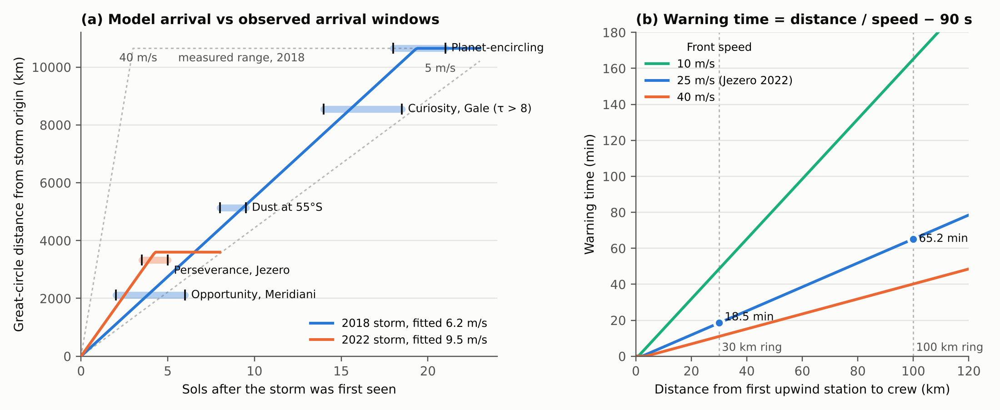
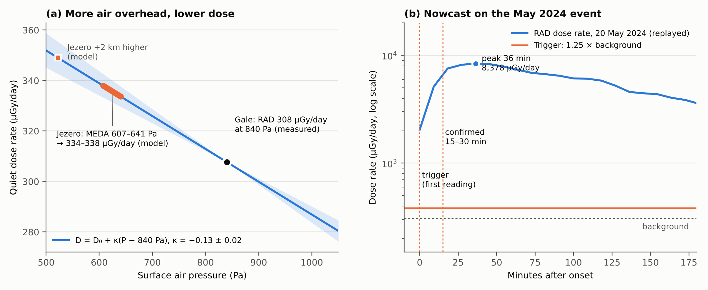

# Research notes: hazards that interrupt an EVA

Why Marswalk re-plans mid-EVA, and where its numbers come from. Statements are paraphrased from the cited sources; app parameters derived from them are marked **(used in app)**.

## 1. Dust storms

### Jezero, January 2022: a storm front crossing Perseverance
- A regional dust storm passed over the Perseverance site on 5–11 January 2022 (Ls 153°–156°); pressure, temperature and winds all responded. — Lemmon et al. 2022, *GRL*, https://agupubs.onlinelibrary.wiley.com/doi/10.1029/2022GL100126
- The storm reactivated west of Jezero on 8 January 2022 (sol 315). Measurements of the rapid expansion of the dust front give **25 ± 2 m/s**. — Sánchez-Lavega et al. 2025, *JGR Planets*, https://agupubs.onlinelibrary.wiley.com/doi/10.1029/2024JE008565 **(used in app: front speed, front comes from the west)**
- In MEDA pressure (section 8, Figure 15), the daily pressure minimum dropped by up to ~60 Pa on sol 313 (~17 h local time) relative to sol 311, and the diurnal (S1) and semidiurnal (S2) tide amplitudes grew by factors of ~2.7 and 4; the conclusions summarise this as 2–3×. — Sánchez-Lavega et al. 2023, *JGR Planets* 128, e2022JE007480, https://arxiv.org/abs/2401.12931
- MEDA sampled at 1 Hz for at least 5 minutes each hour, running continuously only in alternating hours. — Lemmon et al. 2022. A warning network would need continuous sampling.

### Opportunity, June 2018: a storm that grew faster than expected
- First detected 30 May 2018, the storm grew rapidly and was expected to encircle the planet within days. — Spaceflight Now, https://spaceflightnow.com/2018/06/13/huge-dust-storm-knocks-aging-mars-rover-out-of-contact-with-earth/
- It darkened the sky much faster than the 2007 storm. — NASA JPL, https://www.jpl.nasa.gov/news/opportunity-hunkers-down-during-dust-storm/
- NASA lost contact with Opportunity on 10 June 2018; the storm lasted about three months and the rover never answered again. — Eos, https://eos.org/articles/opportunity-rover-mission-complete

### Dust devils: the short-notice, local hazard
- MEDA detects vortices as pressure drops; at Jezero, dust devils are 5–135 m across, and one vortex had a 9.0 Pa drop with 25 m/s winds. Two encounters partially damaged MEDA's wind sensors. — Hueso et al. 2023, *JGR Planets*, https://agupubs.onlinelibrary.wiley.com/doi/10.1029/2022JE007516
- InSight recorded a 9 Pa (13%) pressure drop with a ~20 m/s gust and a 180° wind shift when a vortex passed overhead. — NASA, https://www.nasa.gov/missions/insight/for-insight-dust-cleanings-will-yield-new-science/

### Can storms be forecast?
- There is no known predictor of why one local storm grows to regional scale and another dies. — Lemmon et al. 2022
- Machine-learning forecasts of the OpenMARS reanalysis did not predict large-storm onset; at best they reflected it about 16 hours after it began. — CEUR-WS Vol. 4128, https://ceur-ws.org/Vol-4128/paper2.pdf
- 78% of storms over eight Mars years were preceded by unusually warm, sunny periods; an algorithm predicts some storm types with 64% confidence. — Space.com on Pieris & Hayne (AGU 2024), https://www.space.com/the-universe/mars/sunny-days-on-mars-come-with-a-weather-warning-dust-storms-ahead
- Forecasters argue that reliable prediction needs a network of orbiters and many surface stations. — Space.com, https://www.space.com/34409-mars-weather-forecast-colony-astronauts-weather-extreme-events-dust.html

### What this means for an EVA (our derivation)
Warning lead time from a station *d* km upwind, with front speed *v* and a confirmation delay *c*:

`lead = d / v − c`

| Station distance | Lead at 25 m/s, c = 90 s | Distance a suited crew covers (~3 km/h) |
|---|---|---|
| 10 km | 5 min 10 s | ≈ 0.26 km |
| 20 km | 11 min 50 s | ≈ 0.6 km |
| 30 km | 18 min 30 s | ≈ 0.9 km |

So a crew far from the habitat cannot outrun a front on warning alone. The plan needs a **safe haven within about a kilometre** (here: a pressurized rover staged on the route) and the crew must move on the first detection. The station layout, confirmation delay and rover are Assumptions, not existing infrastructure (see the network section below).

### Weather stations on Mars today, and what has been recommended
- **Today:** Perseverance's MEDA (Jezero) is the only surface weather station whose current status we could confirm. By sol ~1478 its wind sensor ran only 15 minutes every 2 hours (4 h per sol) with damaged boards. — MEDA status, EPSC-DPS 2025, https://meetingorganizer.copernicus.org/EPSC-DPS2025/EPSC-DPS2025-1461.html. Curiosity (with REMS) is still operating at Gale, ~3,700 km away; we did not verify REMS's current status. China's Zhurong carried a climate station but never woke from hibernation after May 2022. — Live Science, https://www.livescience.com/space/space-exploration/china-finally-admits-its-hibernating-mars-rover-may-never-wake-up
- **MEPAG Mars Human Precursor SSG (2005):** a met package on every landed mission; opacity sampled once every 10 minutes through the full sol; surface pressure, wind, temperature, density and dust for at least a Mars year; an orbital "weather station" that tracks storm frequency, size and occurrence and alerts surface-stationed astronauts; pre-descent and pre-ascent sounding probes. It states no number, spacing or layout for a surface network, and says the group did not agree on a minimum number of measurements. — https://hesperia.gsfc.nasa.gov/sspvse/Group_D/MHP_SSG_(06-02-05).pdf
- **NASA Exploration Zone concept:** surface assets concentrated at one landing site; an Exploration Zone is a set of Regions of Interest within about 100 km of it; field-station layouts use ~1 km plume-hazard spacing between landers and the habitat. — Bussey & Hoffman, NTRS 20150013827, https://ntrs.nasa.gov/citations/20150013827; Hoffman, NTRS 20160002370, https://ntrs.nasa.gov/api/citations/20160002370/downloads/20160002370.pdf
- **ESA Mars Weather Network study:** simulated a network of **four landers** at six candidate human exploration zones to reconstruct local winds; no station spacing is given in the abstract. — Rajendran et al., EPSC-DPS 2025, https://meetingorganizer.copernicus.org/EPSC-DPS2025/EPSC-DPS2025-715.html
- **Proposed but not flown:** FMI's MetNet (tens of small landers), MeteoMars penetrators, the MACAWS areostationary constellation.

**How the app uses this (used in app):** default network = a met station at the habitat (MEPAG) plus **four stations on the 100 km Exploration Zone boundary** (count from the ESA study, radius from NASA's EZ). Station positions (N/E/S/W) are our assumption, since no source gives a layout. Two alternatives can be selected for comparison: a compact 30 km ring, and the habitat station alone.

| Network | First detection for a front from the west | Warning to a crew at the habitat |
|---|---|---|
| EZ ring, 100 km | EZ-W | ≈ 65 min |
| Compact ring, 30 km | EZ-W | ≈ 18.5 min |
| Habitat only | HAB | none (detected after arrival) |

## 2. Solar particle events
- August 1972: the largest SEP of solar cycle 20 fell between Apollo 16 and 17; a crew on the lunar surface would have received an estimated 600 rem skin dose and 130 rem to blood-forming organs. — NASA, Working on the Moon, https://www.nasa.gov/wp-content/uploads/static/history/alsj/WOTM/WOTM-Radiation.html; National Academies, *Storms from the Sun*, https://www.nationalacademies.org/read/10249/chapter/11
- 20 May 2024: Curiosity's RAD measured its largest surge since landing, about 8,100 µGy (≈ 30 chest X-rays) for a person beside the rover; not lethal; cliffsides or lava tubes would add shielding. — NASA via Phys.org, https://phys.org/news/2024-06-nasa-mars-epic-solar-storm.html **(used in app: SEP scenario replays this RAD profile)**
- 28 October 2003: a solar event disabled MARIE on Mars Odyssey, the instrument built to measure this radiation. — JPL archive, https://webarchive.library.unt.edu/eot2008/20090512094433/http://mars.jpl.nasa.gov/odyssey/technology/marie.html

## 3. What the app does and does not claim
- The dust front is a **scenario**: a straight line moving east at the measured 2022 speed. Real fronts are irregular.
- Station detections, the confirmation delay and the shelter rover are **assumptions** that illustrate the warning-time arithmetic above.
- Walking pace in dust (85% on own tracks, 70% on new ground) is an **assumption**.
- After sheltering in the rover, the crew waits until the front plus 45 minutes of gusts have passed (winds peaked as the 2022 storm reached Jezero, Lemmon et al. 2022), then drives home sealed inside at 10 km/h. The 45 minutes and 10 km/h are **assumptions**; 10 km/h is the order of top speed quoted for NASA pressurized-rover concepts. For a solar particle event the crew waits until the dose rate is back under the warning level.
- The planet-scale storm footprint is a **kinematic fit** (section 4), not a weather model and not a forecast.
- Radiation shielding by terrain is **not modelled**.

## 4. How far and how fast a storm spreads (planet scale)

Section 1 covers the last tens of kilometres before a front hits a crew. This section covers the thousands of kilometres before that, which is what lets one base warn another.

### What controls spread and reach
| Factor | Evidence |
|---|---|
| **Season** | Large northern storms appear in two windows, Ls 180–240° and 305–350°; southern ones in Ls 135–245°. Non-global activity peaks in Ls 140–250°. — Wang & Richardson 2015, *Icarus* 251 (NASA Mars Data Analysis Program), https://doi.org/10.1016/j.icarus.2013.10.033; Battalio & Wang 2021, *Icarus* 354, https://doi.org/10.1016/j.icarus.2020.114059 |
| **Where it starts, and the channels it follows** | Sequences start mostly in Acidalia, Utopia and Arcadia (north) and Aonia–Solis–Valles Marineris and Hellas (south). Northern routes run north–south through low-lying meridional channels; southern routes run east–west. Many northern sequences "flush" across the equator. — Wang & Richardson 2015; Battalio & Wang 2021 |
| **Size and persistence (feedback threshold)** | In a climate model, a regional-size storm (~10⁶ km²) only changes the surrounding atmosphere enough for self-induced growth when it persists for about 10 sols; a 1-sol storm does not. — "The cascade from local to global dust storms on Mars", Smithsonian profile, https://profiles.si.edu/display/sro_146141 |
| **Radiative–dynamical feedback** | Explosive growth to global scale comes from dust heating strengthening the Hadley circulation and activating secondary lifting centres. — Basu et al. 2006, *JGR*, https://gfdl.noaa.gov/bibliography/related_files/sb0601.pdf; the 2018 storm's equinox onset does not fit this mechanism neatly. — Sánchez-Lavega et al. 2019 |
| **Dust supply** | The NASA Ames GCM study of 2018 examines how finite surface dust reservoirs limit the storm. — Bertrand et al., https://arxiv.org/abs/1908.02453 |
| **Antecedent growth** | Major sequences (peak area above 10⁷ km²) are preceded by six sols of steadily increasing storm area. — Battalio & Wang 2021 |
| **Predictability** | No known predictor of which local storm grows; NASA's Guzewich in 2018: why some storms go global is not understood. — Lemmon et al. 2022; Space.com 2018 |

### Sizes used as thresholds
- Database floor: 10⁵ km². Regional: more than 1.6 × 10⁶ km² and longer than 3 sols (Cantor et al. 2001). Major sequence: above 10⁷ km² (about a 1,800 km radius disc). — Battalio & Wang 2021

### Dated observations the model is fitted to
**2018 planet-encircling storm (MY34, Ls 185°)**
- 30–31 May: 1.4 × 10⁵ km² patch in Acidalia, centred near 31.7°N, 18°W (342°E). 1–8 June: expanded south along the Acidalia corridor at 5 m/s while spreading east and west at 5–40 m/s; dust reached 55°S by 8 June and stopped near 46°N in the north. — Sánchez-Lavega et al. 2019, *GRL* 46, https://arxiv.org/abs/1906.00963
- Opportunity (Meridiani): opacity 10.8 on 10 June; contact lost. — NASA JPL, https://www.jpl.nasa.gov/news/opportunity-hunkers-down-during-dust-storm/
- Curiosity (Gale): dust more than doubled over the weekend of 16–17 June to above 8; declared planet-encircling 19 June. — NASA JPL (same page); Scientific American / Space.com, https://www.scientificamerican.com/article/massive-dust-storm-engulfs-mars/

**January 2022 regional storm (MY36, Ls 153°)**
- A local storm in Hesperia–Promethei grew into one of the earliest large regional storms on record and moved quickly north across the equator into Isidis and Syrtis Major; it affected all NASA surface assets. — Malin & Cantor 2022, MRO MARCI weather report, https://www.msss.com/msss_images/2022/01/12/
- Over Jezero 5–11 January, peak optical depth about 2. — Lemmon et al. 2022, *GRL*

### The model (src/stormsim.js) and how well it fits
The footprint is a disc on the sphere, centre c(t), radius r(t) = min(r_max, v·t), with an optional northern limit and an optional centre track. One speed v per storm is fitted to the dated observations. Checked by `npm test` (`scripts/test_storm.mjs`):

| Storm | v (fitted) | Observation | Observed (sol after first sighting) | Model |
|---|---|---|---|---|
| 2018 | 6.2 m/s | Dust at Opportunity | 2–6 (opacity 10.8 on 10 June) | 3.8 |
| 2018 | | Dust at 55°S | 8–9.5 | 9.3 |
| 2018 | | Gale opacity above 8 | 14–18.5 | 15.5 |
| 2018 | | Planet-encircling | 18–21 | 19.4 |
| 2022 | 9.5 m/s | Over Jezero | 3.5–5 | 4.0 |
| 2022 | | InSight, Curiosity affected | 2–8 | 3.1, 2.7 |

The fitted 6.2 m/s sits inside the measured 5–40 m/s range for 2018: a disc that grows at one average speed matches the dated arrivals, even though the real edge advanced in fast and slow lobes. The 2022 origin point is our reading of a weekly weather map, not a published coordinate. The third scenario, a "typical northern flushing storm" from Utopia past Isidis, is statistical: its track is our sketch of the published route map, its size cap is the 10⁷ km² major threshold, and its speeds are picked inside the measured range.

**Figure 1.** (a) Distance from the storm's origin against time. Lines are the model's footprint edge, r = v·t; bars are observed arrival windows from NASA/JPL reports and Sánchez-Lavega et al. 2019 (2018) and Lemmon et al. 2022 (2022). One fitted speed per storm, 6.2 m/s for 2018 and 9.5 m/s for 2022, passes through every window; the dashed lines bound the 5–40 m/s front speeds measured in 2018. The 2022 footprint stops growing at the 3,600 km regional cap. (b) Warning a crew gets from the first upwind station, distance / speed − 90 s confirmation. At the 25 m/s Jezero front, a 30 km ring gives 18.5 min and a ring at the edge of NASA's 100 km Exploration Zone gives 65 min. Regenerate with `python scripts/plot_storm_model.py`.

### Sharing between bases (what the globe shows)
Bases are placed at four real landing sites (Jezero, Gale, Meridiani, Elysium) so each has a surface record. Crewed outposts there are an **assumption**. Each base learns of a storm from the earliest of: the daily orbital map (MRO MARCI makes one per sol today), a broadcast from a base the storm has already reached, or its own stations. Examples from the model:
- 2018 storm: Meridiani is hit on sol 3.8. Its broadcast gives Jezero 5.3 sols and Gale 11.7 sols of warning, more than either base's own stations (about an hour with a 100 km ring).
- A fast storm (40 m/s in the flushing scenario) reaches Jezero in under 8 hours, before the next daily orbital map: only surface stations and broadcasts warn in time.

### What this does not claim
- It is a replay and sandbox, not a forecast. Storm onset and growth are not predictable today.
- Real storms are lobed, split and merge (MDAD tracks "members" that do exactly this); a disc is the simplest shape that reproduces arrival times.
- The Mars Dust Activity Database itself was not downloaded; its published statistics and thresholds are used.

## 5. Radiation model: background dose from air pressure, and a solar-event nowcast

### What the papers say
**Dose vs pressure.** Guo et al. 2015, *ApJ*, "Modeling the variations of dose rate measured by RAD during the first MSL Martian year", https://arxiv.org/abs/1507.03473
- Fit (section 4, eq. 3): D(Φ, P) = D₀ + κP + βΦ, with Φ the solar modulation.
- Section 4.1.2: κ = −0.13 ± 0.02 µGy/day per Pa for RAD detector E, correlation 98.8%; consistent with Rafkin et al. 2014 (about 0.116 µGy/day/Pa).
- Section 4.1: the diurnal swing is about 15 µGy/day (~5%) out of around 220 µGy/day. Section 4.2.1: mean REMS pressure 840 Pa over the fit period.
- Section 4.1.2: "The measured dose rate decreases when the pressure increases since κ is negative."
- Why: the shielding comes from the atmospheric mass column, which is close to proportional to surface pressure, so dose should also change with elevation. — Rafkin et al., EGU 2013, https://meetingorganizer.copernicus.org/EGU2013/EGU2013-6068-5.pdf

**Solar particle event nowcast.** Löwe et al. 2025, *Space Weather* 23, e2025SW004372, https://arxiv.org/abs/2502.02469
- Trigger (section 3): a reading more than 25% above background, background fitted to the previous five days of 15-minute RAD dose rates. Confirmation (section 5): the next reading is also above the threshold.
- Section 4: 16 SEP events on the surface; average time to peak 3 h 37 min and lead time (time to avoid 90% of the event dose) 1 h 38 min as stated by the authors; "an astronaut should not move more than 30 minutes away from a shelter".
- False alarms: 25% for a single surface reading, zero with the cross-check (section 4.1).

### The model in the app (src/radmodel.js, used in app)
- **Background dose at any elevation:** D = D_Gale + κ (P_local − 840 Pa), κ = −0.13 µGy/day/Pa. P_local is MEDA pressure at the habitat, shifted by the 11.1 km scale height. Applying a fit made on daily pressure swings at Gale to differences in elevation is our **extrapolation (assumption)**. Not applied to solar events, whose surface dose depends on the event's energy spectrum.
- **Route dose:** that dose rate integrated along the route's elevation profile.
- **Alert:** four dose sensors within 100 km of the habitat (**assumption**) each run the Löwe et al. trigger; the alert goes out when two confirm (**assumption**). The crew shelters until the dose rate is back under the trigger level.

**Figure 2.** (a) The Guo et al. 2015 fit through Curiosity's quiet dose at Gale. Jezero's lower MEDA pressure (607–641 Pa) puts its quiet dose about 9% above Gale's; 2 km higher ground would add about 5% more. Within one EVA area (~100 m of relief) the difference is under 1 µGy/day. (b) The nowcast on the May 2024 event replayed in the app, with readings every 15 minutes: confirmed 15–30 minutes after onset, depending on where onset falls between readings; peak at 36 minutes. Regenerate with `python scripts/plot_rad_model.py`; `scripts/test_rad.mjs` checks the numbers.

### What we learned, and do not claim
- **Sensors don't buy time for radiation.** Particles arrive at every sensor at once; a 100 km network confirms the event and rules out a faulty sensor. Warning time comes from the rise to the peak, and from forecasts that watch the Sun.
- **Some events are fast.** May 2024 peaked only 6–21 minutes after the nowcast confirmed. So the 30-minute-from-shelter rule matters more than the alert.
- **Elevation matters across a region, not within one walk.** Planning dose by elevation is useful for choosing a site, not a route.
- Terrain shielding (cliffs, crater walls) is not modelled.

## 6. Decisions under uncertainty

### Monte Carlo odds for each shelter option (src/main.js, `mcSafe`)
The crew knows when and where a station saw the front, not its exact speed. For each option the app runs 2,000 samples: front speed 25 ± 8 m/s kept within 5–40 m/s (centred on the 2022 Jezero front, spread over the range measured in 2018; **assumption**), narrowed to ± 2 m/s once two stations have measured it (the 2022 uncertainty), and walking time ± 10% (**assumption**). An option counts as safe in a sample if the crew is inside before the front reaches the shelter. The dialog tags the **shortest** option (quickest to shelter) and the one with the **best odds**, and still shows the margin at exactly 25 m/s.

### Bases infer the storm instead of being told (src/stormsim.js, `inferStorm`)
No base knows where the storm started. Each only knows when the front reached it. For every candidate origin on a 3° grid, the app fits arrival time = start + distance / speed to the reported arrivals by least squares, keeps origins whose fit is within 0.35 sol, whose speed is 1–40 m/s, and that would not already have covered a base still clear. The consistent origins (dots on the globe) give each base an arrival range (5th–95th percentile). With one report nothing can be inferred.
- 2018 replay: after Meridiani and Jezero report, Gale's range is sol 9.7–24.9; after Elysium also reports, sol 14.7–16.4. The model's arrival is sol 15.5 (`npm test` checks it).
- 2022 replay: the method cannot know a storm will stop growing, so it still predicts Meridiani, which the storm never reached. Inference assumes steady growth.

### Storm effect on pressure and dose (src/environment.js)
During the January 2022 storm, the diurnal and semidiurnal tides over Jezero grew ~2.7× and 4×, summarised by the authors as 2–3×, and the daily pressure minimum dropped by up to ~60 Pa (Sánchez-Lavega et al. 2023, section 8, Figure 15). Once the front passes the crew, the app scales MEDA's whole daily pressure swing about its mean by 2.5 (**assumption**: one factor for all tides, inside the authors' 2–3×; it does not reproduce the 60 Pa drop of the minimum). Dose follows through κ (section 5): the dose rate swings more over the day, while its daily mean barely changes. The dust's own shielding is not modelled. Curiosity met the 2018 storm at opacity 8.5 with visibility down to 2.7 km (Guzewich et al. 2019, GRL, https://doi.org/10.1029/2018GL080839).

### Maya's dose limit left (src/radmodel.js, `limitLeftMSv`)
- On the surface RAD measured 0.21 mGy/day absorbed and 0.64 mSv/day dose equivalent (Hassler et al. 2014, Science), so 1 µGy ≈ 3.05 µSv. The app applies this ratio to solar particles too (**assumption**).
- Limit: NASA's 600 mSv career limit (cited in Löwe et al. 2025). Dose before this EVA: 350 mSv (**assumption**: about 180 days of cruise at 1.8 mSv/day, the RAD cruise rate (Zeitlin et al. 2013), plus weeks on the surface).
- Shown as "Dose limit left" in the visor and in Live conditions.
